# FieldEval 🌲📱

> **A camera-first outdoor vision model evaluation Progressive Web App (PWA) testing open-weight models (Gemma 4 31B) against human ground truth on outdoor fieldwork photos.**

Built for the **[Hacktoberfest Open-Source AI Challenge Week 1: Touch Grass](https://dev.to/challenges/hacktoberfest-week1-2026-10-05)**.

---

## What It Is

Most vision benchmarks evaluate multimodal models on curated, high-resolution indoor datasets under flat studio lighting. Real fieldwork is different: harsh direct sunlight causes high-dynamic-range glare, foliage overlaps in dense 3D planes, and steep perspective angles compress object geometry.

**FieldEval** is an offline-first mobile web application that takes model evaluation outside. A field surveyor walks through a 6-scene evaluation deck, captures photographs of real physical specimens, locks their human ground-truth answer **before** any model is invoked (commit-then-reveal), and then queries an open-weight vision model (**Gemma 4 31B**) to measure exact-match accuracy, paired flip rates across lighting/angles, and failure boundaries.

---

## Screenshots

<!-- [TODO: Replace placeholders with screenshots captured from your mobile device] -->

| 1. Field Deck & Ground Truth | 2. Commit-Then-Reveal | 3. The 6-Scene Results Wall |
| :---: | :---: | :---: |
| <br><sub>6-scene protocol with offline-first guarantee</sub> | <br><sub>Diagonal flagging tape reveal (lime = match, pink = miss)</sub> | <br><sub>Exact Wilson 95% intervals and paired flip rates</sub> |

---

## System Architecture

FieldEval is built as a local-first Progressive Web App with Next.js App Router, using browser IndexedDB for offline photo persistence and a serverless proxy route for provider calls.

```mermaid
sequenceDiagram
    autonumber
    actor FieldUser as Field Surveyor (Mobile Phone)
    participant UI as Mobile PWA Client (Next.js)
    participant IDB as Local IndexedDB (idb)
    participant API as Serverless Route (/api/infer)
    participant Provider as Vision Provider (Gemma 4 / Gemini API)

    Note over FieldUser,UI: Phase 1: Capture & Ground Truth Commitment
    FieldUser->>UI: Photograph specimen (<input capture="environment">)
    UI->>UI: Canvas resize (max 1024px, JPEG Q0.82, strips EXIF/GPS)
    UI->>IDB: Save normalized JPEG blob to "blobs" store
    FieldUser->>UI: Input answer & tap "Lock my answer"
    UI->>IDB: Persist Observation with locked_at timestamp

    Note over UI,Provider: Phase 2: Model Inference & Reveal
    alt Connected to Network
        UI->>API: POST /api/infer { imageBase64, mimeType, taskId, sessionId }
        API->>API: Validate payload (Zod) & build prompt from task deck
        API->>Provider: Call Gemma 4 (gemma-4-31b-it)
        Provider-->>API: ModelResult { answer, rationale, confidence, tokens }
        API-->>UI: Return ModelResult JSON
        UI->>IDB: Store model outcome & score
        UI->>FieldUser: Reveal tape slap (Lime = Match / Pink = Miss)
    else Offline in Backcountry
        UI->>IDB: Mark observation as queued_offline
        UI->>FieldUser: Banner: "Offline. Photo saved to phone."
    end

    Note over UI,FieldUser: Phase 3: Benchmark Synthesis & Export
    FieldUser->>UI: Complete 6-scene deck -> Navigate to Results
    UI->>IDB: Fetch session observations
    UI->>UI: Compute Wilson 95% intervals, task stats, and flip rate
    FieldUser->>UI: Tap "Export results file (.jsonl)"
    UI->>FieldUser: Web Share Sheet / JSONL Download (fieldeval.v1)
```



### Architecture Specifications
- **Data Flow & Decisions**: Detailed rationale for every architectural trade-off is documented in [`docs/ARCHITECTURE.md`](docs/ARCHITECTURE.md).
- **Data Contract & Schemas**: Field-by-field definitions for `TaskDef`, `ModelResult`, `Observation`, and `ExportRecord` are documented in [`docs/DATA_SCHEMA.md`](docs/DATA_SCHEMA.md).
- **Inference Pipeline Observability**: Distributed tracing with `@sentry/nextjs` is documented in [`docs/OBSERVABILITY.md`](docs/OBSERVABILITY.md).

---

## Setup & Environment Variables

### Prerequisites
- Node.js 20.x or higher
- npm 10.x or higher

### Environment Variables
Configure these variables in `.env.local` (see [`.env.example`](.env.example)):

| Variable Name | Required? | Secret? | Default Value | Description |
| :--- | :---: | :---: | :---: | :--- |
| `GEMINI_API_KEY` | **Yes** | **Secret** | *None* | Google Gemini API key used by `@google/genai` to invoke Gemma 4. |
| `DAILY_CAP` | No | Non-Secret | `300` | In-memory daily inference cap to protect API quotas. |
| `PROVIDER` | No | Non-Secret | `gemini` | Vision provider adapter (`gemini`). |
| `MODEL_ID` | No | Non-Secret | `gemma-4-31b-it` | Model identifier for Gemma 4. |
| `SENTRY_DSN` | No | Secret / Sensitive | *None* | Sentry project DSN for serverless pipeline tracing. |

### Running Locally

```bash
# 1. Install dependencies
npm install

# 2. Copy environment template and add your API key
cp .env.example .env.local

# 3. Start development server (accessible over LAN for mobile testing)
npm run dev
```

Visit `http://localhost:3000` on your desktop or `http://<YOUR_LOCAL_IP>:3000` on your phone.

---

## Running Tests

FieldEval includes a complete test suite covering image processing mathematics, evaluation scoring logic, defensive JSON parsing, JSONL round-trip serialization, and route validation:

```bash
# Run all unit tests with Vitest
npm run test

# Run TypeScript typechecker
npm run typecheck

# Run production build
npm run build

# Run automated smoke test against a running instance
node scripts/smoke.mjs http://localhost:3000
```

---

## 🔒 Privacy & Data Handling

FieldEval was designed for environmental researchers and field surveyors who need zero data leaks in sensitive field locations:

1. **What Stays on the Phone**:
   - All high-resolution and normalized photos remain exclusively in browser IndexedDB.
   - Human ground truth answers, timestamps, and revision histories are stored on-device.
   - Nothing is uploaded to third-party photo clouds (no S3, no Firebase, no Cloudinary).
2. **What Is Sent to the Server & Model**:
   - Only the single photo currently being evaluated is sent to `/api/infer`.
   - The photo is resized to a max edge of 1024px at JPEG quality 0.82 on an HTML canvas, which automatically strips all EXIF metadata, GPS coordinates, and camera serial numbers.
   - The client sends only a `taskId` (e.g. `task-specimen-count`). Prompts are constructed server-side; client-supplied arbitrary prompts are rejected.
3. **What Is Never Stored on the Server**:
   - The server processes images in-memory and immediately discards them. No photos or request bodies are saved to server disk or databases.
   - GPS coordinates and device identifiers (user-agent, IMEI, IP addresses) are never captured or logged.
   - Sentry distributed tracing operates with `sendDefaultPii: false`, `dataCollection.userInfo: false`, `dataCollection.httpBodies: []`, and regex redaction of API keys.

---

## Limitations

FieldEval is an empirical tool with deliberate, transparent boundaries:
1. **Small Sample Size ($N = 6$ to $30$)**: A walk of 6 to 30 photos taken by one person on one afternoon cannot prove general model capabilities across global biodiversity or varied geographic biomes.
2. **Wide Statistical Confidence Intervals**: Wilson 95% score intervals are wide with small sample sizes. The UI explicitly displays intervals as `[lower, upper]` rather than claiming precise percentage accuracy.
3. **Paired Consistency Focus**: The benchmark prioritizes paired consistency (e.g. overhead flat lay vs. 45° angle) to identify specific visual failure modes rather than claiming statistical benchmark dominance.
4. **Network Requirement for Scoring**: While image capture and ground truth locking work 100% offline, model scoring requires an active cellular or Wi-Fi connection to query the Gemma 4 provider.

---

## Licence & Attribution

- **Application Code**: Licensed under the [MIT License](LICENSE).
- **Model Attribution**: **Gemma 4** (`gemma-4-31b-it`) is developed by Google DeepMind / Google and released under the **Apache 2.0 License** (as stated on the official [Gemma 4 licence documentation](https://ai.google.dev/gemma/terms)).
- **Typography Attributions**:
  - **Bricolage Grotesque**: Designed by Mathieu Triay, licensed under the [SIL Open Font License 1.1](https://openfontlicense.org).
  - **Literata**: Designed by TypeTogether (Veronika Burian and José Scaglione), licensed under the [SIL Open Font License 1.1](https://openfontlicense.org).

---

## Deadline & Commit Log

- **Challenge Deadline**: October 11, 2026, 11:59 PM PDT (October 12, 2026, 06:59 AM UTC).
- **Commits Made After Deadline**:
  - *None. All development and initial release commits were committed and submitted prior to the challenge deadline.*
