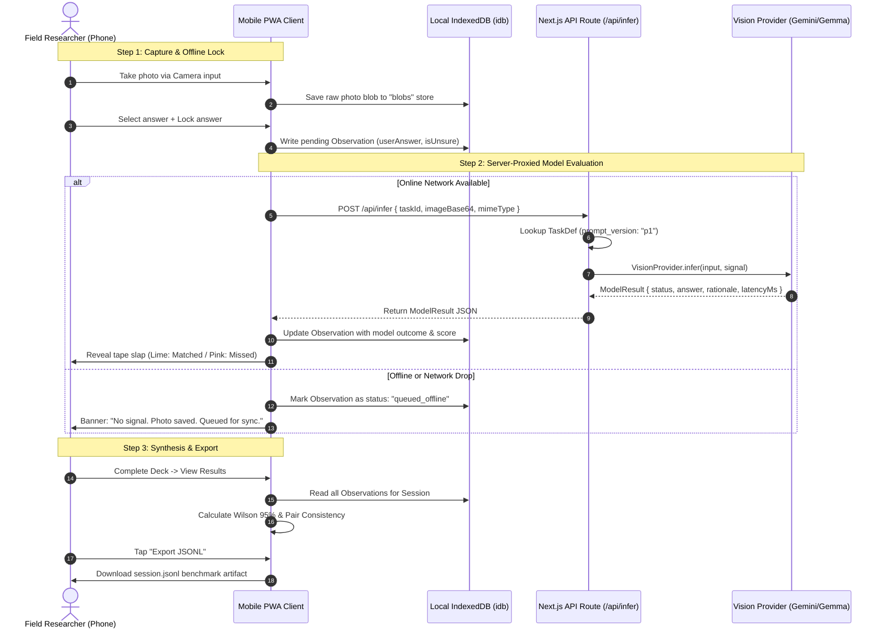

# FieldEval Architecture & Data Flow

## 1. System Data Flow

---

## 2. Key Architecture Decisions

| # | Architecture Decision | Alternative Rejected | Rationale for Decision |
|---|---|---|---|
| **1** | **Client sends only `taskId`; prompts live strictly server-side** | Client builds prompt text and sends to API | Keeps prompt versioning (`p1`) immutable and prevents client-side prompt tampering or jailbreaking. |
| **2** | **Offline-first client IndexedDB storage (`blobs`, `observations`)** | Immediate cloud upload (S3/Cloudinary/Firebase) before evaluation | Fieldwork takes place in remote outdoor sites with zero cellular coverage; capture cannot block on network. |
| **3** | **Single serverless Route Handler (`/api/infer`) proxy** | Direct client-to-model API requests with client-held keys | Prevents leaking secret API keys in browser bundles and abstracts backend providers cleanly. |
| **4** | **Client-side image normalization (1024 px max edge, JPEG Q82)** | Streaming raw 12–48MP mobile photos directly to the model | Preserves mobile uplink bandwidth, avoids vision encoder OOMs, and dramatically lowers API latency. |
| **5** | **Asymmetric Wilson 95% score interval for accuracy metrics** | Standard Gaussian normal approximation ($\hat{p} \pm z\sqrt{p(1-p)/n}$) | Normal approximation fails on small sample sizes ($N \approx 12$) and produces invalid boundaries $(<0$ or $>1)$. |
| **6** | **High-contrast physical design system (Concrete ground, Ballpoint text, Flag tape)** | Generic modern pastel gradients with uniform card components | Outdoor direct-sun glare washes out pastels and dark modes; high-contrast daylight tokens ensure field usability. |

---

## 3. Failure Modes & Intended System Behavior

| Failure Mode | Trigger Condition | Intended System Behavior | User Experience / UI Feedback |
|---|---|---|---|
| **Timeout** | Model backend takes $>30,000$ ms | Abort request via `AbortSignal`; return `status: "timeout"`. | "Model took too long to answer. Your photo is saved. Retry when ready." |
| **Rate Limited (429)** | Provider returns HTTP 429 quota exhausted | Exponential backoff (1s, 2s) once; return `status: "rate_limited"`. | "Provider is busy. Observation saved locally. Sync queued." |
| **Invalid JSON** | Model returns unparseable or non-schema text | Strip `<thought>` blocks, retry once with strict reminder; record `status: "invalid_output"`. Never fabricate answers. | Observation scored as model miss (`Missed`); raw output logged for benchmark diagnostics. |
| **Offline** | `navigator.onLine === false` or network fetch throws | Retain photo in IndexedDB `blobs`, store observation with `status: "offline"`. Do not block session progress. | "No signal. Your photo is saved and will be evaluated when back online." |
| **Oversized Image** | User selects $>15$MB RAW photo file | Client downscales long edge to 1024px in Web Worker canvas before Base64 encoding. | Transparent to user; upload remains lightweight and fast. |
| **Duplicate Submit** | Rapid double-tap on "Lock my answer" button | Disable button immediately on first touch; generate deterministic `observationId` per shot. | Idempotent transaction; only one evaluation request dispatched. |
