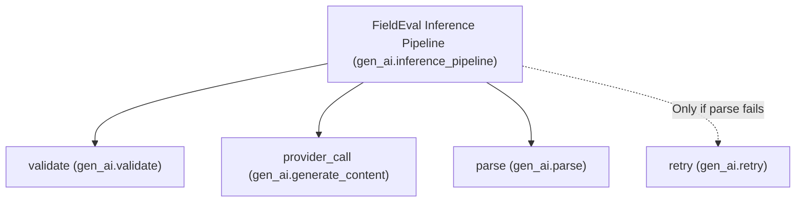

# FieldEval Observability & Sentry Tracing Guide

This document describes the Sentry distributed tracing implementation for FieldEval's outdoor vision model evaluation pipeline.

---

## 1. Architecture & Setup

FieldEval instruments **only the server-side inference pipeline** running in the Node.js runtime. Client-side telemetry, browser tracking, and Edge runtimes remain strictly disabled to preserve zero-data-leak fieldwork guarantees.

### Key Files
- [`sentry.server.config.ts`](file:///d:/projects/greenforest/sentry.server.config.ts): Server initialization with strict data privacy filters and sampling rate.
- [`src/instrumentation.ts`](file:///d:/projects/greenforest/src/instrumentation.ts): Next.js 15 instrumentation hook registering Sentry on server startup.
- [`next.config.mjs`](file:///d:/projects/greenforest/next.config.mjs): Bundler integration wrapped via `withSentryConfig` from `@sentry/nextjs/config`.
- [`src/app/api/infer/route.ts`](file:///d:/projects/greenforest/src/app/api/infer/route.ts): Root trace and input validation span.
- [`src/lib/providers/gemini.ts`](file:///d:/projects/greenforest/src/lib/providers/gemini.ts): LLM provider call, defensive parse, and retry spans with token metrics.

---

## 2. Trace Hierarchy & Pipeline Spans

Every observation submitted to `/api/infer` generates **one root trace** named **`FieldEval Inference Pipeline`** (`gen_ai.inference_pipeline`), encompassing up to four discrete spans:



### Spans Breakdown

| Span Name | Operation (`op`) | Description | Attributes Recorded |
| :--- | :--- | :--- | :--- |
| **`FieldEval Inference Pipeline`** | `gen_ai.inference_pipeline` | Root transaction covering end-to-end observation evaluation. | `model_id`, `gen_ai.request.model`, `latency_ms`, `status`, `attempts`, `task_id`, `session_id`, `gen_ai.usage.prompt_tokens`, `gen_ai.usage.completion_tokens`, `gen_ai.usage.total_tokens` |
| **`validate`** | `gen_ai.validate` | Zod schema parse, task ID resolution from deck, 1.5MB size guard, hourly/daily rate limiting. | `task_id`, `session_id`, `mime_type`, `latency_ms`, `status`, `attempts` (1) |
| **`provider_call`** | `gen_ai.generate_content` | Network roundtrip to Gemini API calling Gemma 4 vision model (`@google/genai`). | `model_id`, `gen_ai.request.model`, `latency_ms`, `status`, `attempts` (1), `prompt_tokens`, `completion_tokens`, `total_tokens`, `thoughts_tokens` |
| **`parse`** | `gen_ai.parse` | Defensive JSON extraction and Zod schema parsing of model output. | `latency_ms`, `status` (`ok` \| `invalid_output`), `attempts` (1) |
| **`retry`** | `gen_ai.retry` | Stricter prompt generation and second model call (triggered *only* if initial parse fails). | `model_id`, `gen_ai.request.model`, `latency_ms`, `status`, `attempts` (2), token metrics |

---

## 3. Strict Privacy Guarantees (Zero Leakage)

FieldEval enforces rigorous privacy and redaction rules across the Sentry SDK configuration:

### What is NOT Captured
1. **NO Images or Image Bytes:** Image base64 strings, decoded buffers, and file contents are never attached as attributes, tags, breadcrumbs, or context.
2. **NO Task Prompts:** Prompts are built purely server-side from task definitions and are never attached to span attributes.
3. **NO Model Rationale or Raw LLM Output:** `rationale` and `rawOutput` text are excluded from spans and events.
4. **NO Request Bodies:** `dataCollection.httpBodies: []` disables HTTP body collection, and `beforeSend` explicitly deletes `event.request.data`.
5. **NO Default PII:** `sendDefaultPii: false` and `dataCollection.userInfo: false` prevent IP, user, or cookie collection.
6. **API Key Redaction:** `beforeSend` strips `x-goog-api-key` and `authorization` headers, and regex-redacts any occurrence of `GEMINI_API_KEY` from messages and stack traces.

### What IS Captured
- **Pipeline Metadata:** `task_id` (e.g., `task-specimen-count`), `session_id`, `mime_type`.
- **Operational Status:** `status` (`ok`, `invalid_output`, `timeout`, `rate_limited`, `error`).
- **Performance Metrics:** Phase latency (`latency_ms`), pipeline wall time, attempt count (`attempts`).
- **Token Usage:** `gen_ai.usage.prompt_tokens`, `gen_ai.usage.completion_tokens`, `gen_ai.usage.total_tokens` (from `usageMetadata`).

---

## 4. Where to Find Traces in the Sentry Dashboard

Traces are routed to your Sentry project configured under `SENTRY_DSN` (Organization: `goelsahhab-workspace`, Project: `javascript-nextjs`).

### 1. Performance & Tracing Explorer
- Navigate to **Performance** $\rightarrow$ **Traces** (or **Explore** $\rightarrow$ **Traces**).
- Search query:
  ```text
  transaction:"FieldEval Inference Pipeline"
  ```
- Click any trace to view the waterfall visualization displaying:
  - `FieldEval Inference Pipeline`
  - Child span `validate`
  - Child span `provider_call`
  - Child span `parse` (and `retry` if triggered)

### 2. LLM / AI Insights Dashboard
- Navigate to **Insights** $\rightarrow$ **AI** (or **LLM Monitoring**).
- Filter by model: `gemma-4-31b-it`.
- View token usage distributions, p50/p95 latency metrics, and invocation volume across time.

### 3. Spans Explorer
- Query by operation:
  - `op:gen_ai.validate`
  - `op:gen_ai.generate_content`
  - `op:gen_ai.parse`
  - `op:gen_ai.retry`
- Inspect tag filters: `task_id`, `status:ok`, `status:invalid_output`, `status:timeout`.
